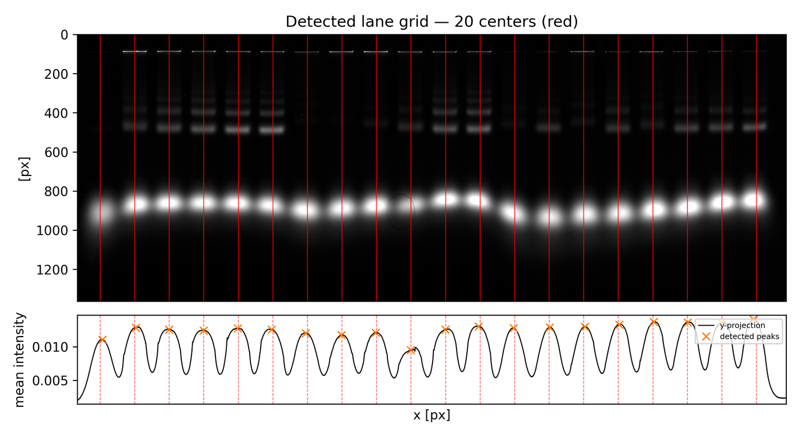
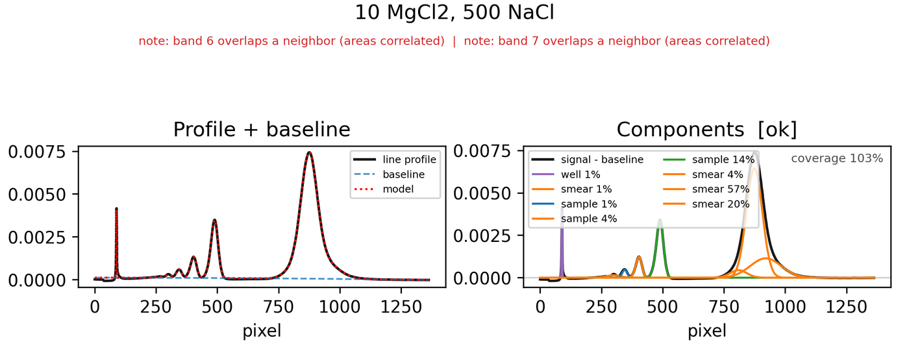
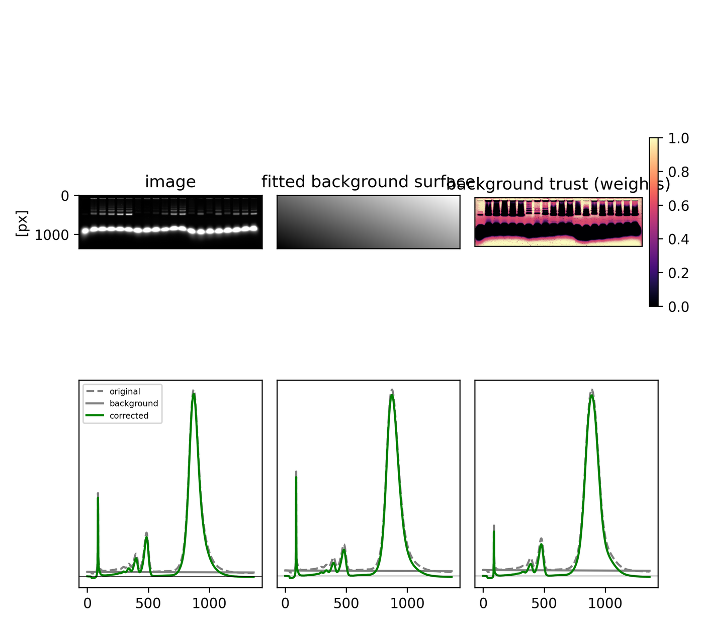

No gelpy renderer writes a result or changes a number, so re-rendering is always safe. It is
not free and not read-only, though: a `corrected` render computes and caches the background if
that is not cached yet (a 51 MB npz on this gel, and no manifest entry for it), and the
background and fit figures each recompute their own input -- the background fit, the baseline --
on every call. The lane-detection overlay recomputes nothing: `lanes detect` draws it from the
detection it has just run. What a figure cannot do is alter a stored number.
It works the other way round: a wrong number is usually invisible in `results.csv` and obvious
in the figure, which is what this page is for.

Set the two variables the blocks below use, then build a run folder to look at. This first
block is skipped by the test that executes the rest, because that test sets both itself:

```bash
# doc-test: skip
export IMAGE=examples/data/example_gel_1.tif
export RUN=./run-figures
```

```bash
gelpy init "$RUN" "$IMAGE" --n-lanes 20
gelpy lanes detect "$RUN" --apply
gelpy background remove "$RUN" --plot
```

## Two views of the same gel, and why they must stay separate

`gelpy image show` writes one PNG per `--kind` into `render/`. It draws no lane overlay unless
you pass `--lanes`. <!-- claim: image-show-draws-no-lane-overlay-by-default -->

```bash
gelpy image show "$RUN"
gelpy image show "$RUN" --lanes
```

```text
{ "image": ".../render/corrected.png" }        # clean, no overlay
{ "image": ".../render/corrected_lanes.png" }  # --lanes
```

The overlay render gets a `_lanes` suffix so it can never clobber the plain render of the same
kind (`cli/_render.py:85-86`). Keep both files, and keep them apart:

- **`corrected.png` is the deliverable.** Clean grayscale gel, lane labels along the top edge,
  nothing drawn over the sample -- and on its own, no evidence that the profiles came from the
  right columns.
- **`corrected_lanes.png` is the QC artifact** that supplies that evidence, and nothing else.
  Each red rectangle is the column strip `extract_line_profile` averages for that lane --
  `x_center_px ± profile_width_px/2`, full image height (`render/images.py:73-80`). Not to the
  pixel: the rectangle uses the float bound while the extractor int-truncates and clips to the
  frame (`core/line_profiles.py:17-22`), so a strip running off an edge would be overstated by
  the drawing. Neither bites on `example_gel_1` -- `profile_width` 159 px against a 228.4 px
  pitch is 70% of the pitch, 68% of the frame sits inside a strip, and no strip reaches an edge.
  At `facecolor=(1, 0, 0, 0.12)` the gel stays readable through the tint, but red over 68% of
  the frame makes a poor picture of a gel.

The **lane tick labels are drawn whenever the recipe has lanes**, with or without `--lanes`,
rotated by `LaneLayout.label_rotation` and moved to the top edge (`render/images.py:82-84`).
They do not obscure the sample, so they are useful on the plain view too; only the rectangles
are opt-in.

In `corrected.png`, **the large pure-black regions are pixels below the fitted background**,
clamped to zero for display only (`render/images.py:18-29`). The cache keeps them signed --
rectifying them would bias every band area upward. Measured on this run, 22% of the corrected
array is negative, including 52% of the top 120 rows (the well row) and 72% of the bottom 200.
With the default gamma of 0.1 an intensity of 1e-4 already renders at 0.40, so anything that
reads as true black is at or below zero, not merely dim. Inspect those excursions in
`background show`, which plots the signed residual on purpose.

Which array and which contrast each `--kind` selects is
[image-input.md](image-input.md#display-contrast-is-display-only)'s subject, not this page's.

## `render/lane_detect.png` -- did the grid land on the lanes

Written by `lanes detect` unless you pass `--no-plot`. Two panels sharing an x axis, so a
feature in the projection is directly under the same column of the image.



**Top panel.** The gel at a **fixed 1 to 99.5 percentile stretch, independent of the run's
`ContrastConfig`** (`render/lanes.py:35-36`), so `gelpy contrast set` cannot change this figure.
The stretch is linear -- no gamma -- so this panel is far less sensitive at the low end than a
gamma-0.1 view of the same array. Measured on `example_gel_1` the window is 0.0011..0.1138, and
the brightest pixel of lane index 7 (`300 NaCl`) in rows 300-600 is 0.0105: 0.08 here,
effectively black, against 0.63 under gamma 0.1, where it is plainly a band. **An invisible lane
here is not evidence the lane is empty** -- check `image show --kind non_linear` first. One
solid red line per center.
`aspect` is forced to `auto` (`render/lanes.py:42`), so the gel is stretched to fill the panel
-- never judge band shape here.

**Bottom panel.** The column projection in black (mean intensity over the rows used), orange
`x` at the peaks the detector found, red dashed at the centers the fitted grid placed. The
comparison between orange and red is the entire point of the two panels:

- **Orange on red, everywhere.** What was found and where lanes were placed agree.
- **A red line with no orange x near it.** A grid node inferred without a peak -- an empty or
  skipped well. Expected and fine; glance at the top panel to confirm the lane is empty.
- **A constant offset between every orange x and its red line.** Phase error. The grid is
  `offset + k·pitch` by construction, so a wrong offset displaces every node identically.
- **An offset that grows from one end of the frame to the other.** Wrong pitch, same
  arithmetic. Both are fixed by reading the two outer centers off this figure and passing them
  to `lanes set --endpoints`; the ladder is in [lane-placement.md](lane-placement.md).
- **A narrow spike carrying an orange x.** Dust or a scratch, not a lane.
  Compare widths rather than heights: a loaded lane projects to a broad bump, because it is
  ~145 px wide in x and every one of those columns projects to a similar row-mean. Measured on
  `example_gel_1`, the 20 lane bumps are 133 to 156 px wide (median 143.5) at half the depth
  between the bump maximum and its neighbouring troughs, against a 228.4 px pitch -- 0.63 of
  the pitch. Anything a few pixels wide is not a lane, whatever its height.

One wrinkle if you measure that offset by eye: the `x` mark peaks of a moving average of the
projection (window `0.7 x` the expected pitch `width/N` -- 164 px here), while the black curve
under them is the **unsmoothed** projection. So an `x` usually does not sit on a local maximum of
the curve it is drawn on: measured here, up to 30 px off its bump's maximum, median 6.5 px.
Expect that much jitter before calling a phase error.

A **deepskyblue horizontal band** appears when the projection was built from a subset of rows:
either an adaptive strategy's chosen `y_band`, or a manual window
(`render/lanes.py:48-55`). Without one, the projection is full height and nothing is shaded.

```bash
gelpy lanes detect "$RUN" --y-start 700 --y-end 1000
```

That shades rows 700 to 1000 and reports `"applied": false` -- but it still overwrites
`render/lane_detect.png`, which is a single fixed filename. **The overlay on disk is the last
detection you ran, not necessarily the layout in `recipe.json`.**

## `render/profiles_*.png` -- the lane profiles overlaid

One line per selected lane, x in image rows offset by `slice_start`, y labelled with the
normalization that produced it (`render/profiles.py:26-31`). There is no title: the legend names
the lanes, but only the filename says which selection this file is, and
[line-profiles.md](line-profiles.md) owns the naming rule and the normalization semantics.

```bash
gelpy profiles extract "$RUN" --plot
```

What to read here is **shape and registration**, not height. With the default `area`
normalization each curve integrates to 1 over its own slice, so absolute intensity is gone by
construction; what remains is where each lane's bands sit and whether a band that should be
common to all lanes has drifted. On this gel the product band's maximum runs from row 846 to
row 934 across the 20 lanes, an 88 px spread -- the kind of thing that is invisible in a table
and unmissable here.

Caveat: matplotlib's default color cycle has 10 entries, so on a 20-lane plot **lane 1 and
lane 11 are drawn in the same blue**. Use the legend order, or plot fewer lanes.

## `render/fits/lane_NNN.png` -- the per-lane verdict

The densest figure in the package, and the one you must actually look at before reporting a
number. `fit run --plot` and `fit refit-lane --plot` write one per lane, at
`render/fits/lane_<index:03d>.png` (`runfolder/layout.py:149-150`).

```bash
gelpy fit run "$RUN" --lane 5 --plot
ls "$RUN/render/fits"
```

`fit run` does not report that path in its JSON -- `files` carries the results files and the
report only -- so construct it from the lane index. `fit refit-lane` reports it, as a
run-relative `files.plot`, only when it rendered the plot: without `--plot` the key is absent.
The listing also shows `index.json`, which is no figure: it records which fit, and under which
label, each PNG shows, so that `report html` draws only the plots that are out of date. A lane's
entry is dropped while its plot is drawn and written once the plot is on disk, so a draw that was
interrupted is drawn again.



**Figure title** is the lane's label as the recipe has it when the plot is drawn, also for a lane
relabelled after it was fitted (font drops from 12 to 9 above 30 characters). Under it, in
red, **the first two `confidence_reasons`** if there are any (`render/fits.py:86-95`). Red text
here is not a failure; `note: band 6 overlaps a neighbor (areas correlated)` names a band whose
area is not independently identifiable from its neighbour's.

**Left panel, "Profile + baseline".** Black is the sliced and normalized profile the fit
actually saw. Blue dashed is the estimated baseline. Red dotted is `baseline + Σ components`,
drawn only when the fit produced bands. **Black and red should be indistinguishable.** Where
red sits below black there is unmodelled signal; where it sits above, the model overshoots.
The blue dashed line should look like smooth drift and never climb into a peak.

**Right panel.** Its title is `Components` followed by the lane's `confidence` in brackets
(`render/fits.py:52`) -- the bracketed word is the confidence, not the status. Black, behind
everything, is `signal - baseline`. Each component is drawn in its class color and labelled
`<class> <area_fraction>`:

| class | color |
|---|---|
| `well` | purple |
| `smear` | orange |
| `dust` | gray |
| `sample`, `unknown` | the next entry of matplotlib's default cycle |

A region-integrated smear -- a band with no fitted shape -- is drawn as a translucent filled
area under the data instead of a curve (`render/fits.py:64-68`).

**Read the labels, not the colors.** The default cycle's 2nd, 5th and 8th entries are exactly
`tab:orange`, `tab:purple` and `tab:gray`, so a lane's second `sample` component is drawn in
precisely the smear color. That is not hypothetical: in the figure above, `sample 4%` is the
same orange as the four smears.

**`coverage` sits in the top-right corner and should read about 100%.** It is
`Σ area_k / ∫(y − baseline)`. Above 100% is normal and not a bug: overlapping components can
each claim part of the same signal, and each *shape-fitted* component's area is a closed-form
integral over the whole real line (`core/peaks/base.py:58-59`) against a finite-window
denominator. The region-integrated smear is the exception -- its area is a finite trapezoid over
its own window (`core/peaks/strategies/_common.py:121-124`). Lane 5 of this run reads 103%; the
walkthrough's 20 lanes span 0.999 to 1.037.
Far from 100% means the decomposition does not account for the signal, and the number to report
is then `residual_fraction`, not an area.

**A failed or empty lane still renders.** The right panel prints `fit empty` or `fit failed`
centered, with no components and no coverage; the left panel still shows profile and baseline
without the red model curve. The engine's own empty result carries `confidence="low"` and the
reason `no significant signal detected` (`core/peaks/strategies/_common.py:93-99`), so that
panel's bracketed word reads `low`.

Two things here will catch you out:

- **The x axis is slice-relative.** It starts at 0 = the first sample of the slice, and
  `maximum_position` in `results.csv` is on the same basis. To get an image row, add
  `slice_start` from `fit_config.json`. The profiles overview *does* offset by `slice_start`;
  this figure does not.
- **The baseline is recomputed at render time** from the lane's stored config, because the
  strategies fit the baseline-subtracted signal and the array is not kept in the result
  (`cli/_render.py:187`). It is deterministic given `fit_config.json` -- but if you hand-edit
  that file after a fit, the drawn baseline belongs to the edited config while the components
  belong to the old fit. A lane with no entry in `fit_config.json` at all is drawn with a flat
  zero baseline and the default slice.

## `render/background_diagnostic.png` -- one filename, two different figures

`background remove --plot` and `background show` both write this one file, and which figure
they write depends on the model (`cli/_render.py:433-449`). Both are recomputed from the recipe
on every call; the diagnostics are not cached, so `background show` costs a full re-fit.



For `robust_plane` and any other fitted-surface model, three top panels over three profile
panels:

- **image** at a fixed 5 to 95 percentile window.
- **fitted background surface**, on matplotlib's autoscale -- its own min to max. It therefore
  always looks like a dramatic gradient. Read shape, never magnitude.
- **background trust (weights)**, magma, pinned to 0..1 with a colorbar. Bright means the pixel
  was trusted as background, dark means the fit ignored it. This is the panel that tells you
  whether the fit worked; [background.md](background.md) has the judgment calls. A model that
  returns no weight map leaves this panel blank (`render/background.py:99-100`).
- **bottom row**: three column bands across the image width, each showing original (gray
  dashed), fitted background (gray solid) and corrected (green), with a zero reference line.
  **The x axis of these three is the image row**, i.e. the migration direction, because the
  mean is taken across columns (`render/background.py:104-110`).

This figure does **not** clip the corrected trace, and `robust_plane` keeps signed residuals by
default, so green dipping below zero between bands is the residual doing its job.

`plane_ransac` gets a different figure: the image with the fit stripes in red, over the same
three profile panels. There the corrected trace **is** clipped at zero for display
(`render/background.py:32-33`), so a green trace resting on a hard zero floor is the clipping,
not the fit. Its title says "and validation slices", but nothing in that panel marks them --
the slices are the three lower panels.

## `report.md`

Not a figure, but written by the same layer, and refreshed on every `fit run` and
`fit refit-lane` whether or not you asked for plots. Four header fields (source image by file
name and sha256, not by path, so the report reads the same wherever it is copied; dimensions as
width x height, lane count and profile width, background model), then one row per band, then one
line per lane with its band count, coverage and any low-confidence reasons.

```bash
head -6 "$RUN/report.md"
```

Its table is an abridgement of `results.csv` with renamed headers: `band` is `band_number`, `x`
is `maximum_position`, `class` is `component_class`, and `shape`, `area`, `area_uncertainty`,
`residual_fraction`, `method` and every `param_*` column are absent (`render/report.py:35-60`).
Read `report.md` to orient, report from `results.csv`. `x` is the same slice-relative
coordinate as the fit figure's axis, and nothing in the report records the slice.

`gelpy report html` puts the gel views, the tables and these figures on one page:
[html-report.md](html-report.md).

## Figure geometry

Every PNG is written at **300 dpi**, passed explicitly at every `savefig` (measured 299.9994 on
every file the blocks above produced). Figures are sized in centimetres via `cm_to_inch`:
`<kind>[_lanes].png` 18 x 12, `lane_detect.png` 22 x 12, `profiles_*.png` 18 x 10,
`fits/lane_NNN.png` 19 x 7.5, `background_diagnostic.png` 18 x 16. The first and the third are
saved with a tight bounding box, so their pixel size varies with how much label and legend
furniture sits outside the axes -- 1901 x 684 and 2138 x 1361 on this run. The other three are
fixed: 2598 x 1417, 2244 x 885, 2125 x 1889.

Every PNG is written to a temporary file next to its path and renamed over it (`render/_figure.py`,
on `utils/atomic.py`): a figure that fails to draw leaves the previous one in place, and a link at
the path is replaced and never written through. A lane label is drawn as plain text: a `$` in it
is a dollar sign and never starts mathtext, so a lane called `$\frac$` draws like any other.

## Known limitations

- **Nothing is deleted from `render/` except by `init --force`, which removes the whole
  directory.** Every renderer overwrites a fixed name, so the directory accumulates.
  `render/fits/lane_NNN.png` is keyed on lane index only: a refit overwrites it, and there is
  no history.
- **A fit PNG can outlive the fit it shows.** `results show` and the HTML report leave out a fit
  whose hash no longer matches the current recipe (`runfolder/results.py:26-46`), and so do the
  `results.csv` and `report.md` that the next fit pass writes; the PNG is not filtered and stays on
  disk. After a recipe edit, trust `results show` and re-render the plots. The HTML report draws
  a plot again when the one on disk shows another fit or another label (`render/fits/index.json`
  records what each plot shows).
- **A lane with no cached fit is skipped silently.** `--plot` produces no PNG and no error for
  it, so an absent `lane_NNN.png` means "never fitted", not "fit failed".
- **The three top titles of the background diagnostic collide** on a wide gel: the figure is
  18 x 16 cm regardless of the image's aspect ratio, so on `example_gel_1` (3.4:1) the panels
  shrink toward the middle of the row while the titles do not. Cosmetic, but it looks like a
  bug the first time.
- **The coverage annotation can be hidden by the legend.** It is drawn at a fixed (0.98, 0.95)
  in axes coordinates while the two-column legend is auto-placed, so on a lane whose signal
  leaves the top right empty the legend can land on top of it. Read `coverage` from
  `results.json` if the figure is ambiguous.
