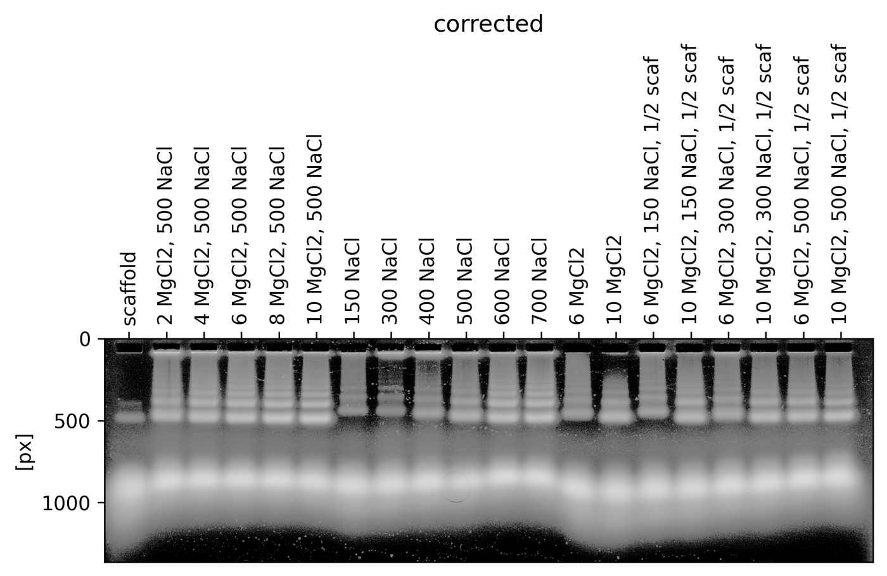

<!-- GENERATED by tools/build_walkthrough.py -- do not edit.
     Every command below was executed against examples/data/folding_screen.tif and
     every number was read out of the resulting run folder. Edit the prose in
     tools/walkthrough_template.md and regenerate. -->

# A real gel, start to finish

This page was **generated by running the analysis**, not written. Every command below was
executed against `examples/data/folding_screen.tif`, every transcript is that command's actual
output, and every number in every table was read out of the resulting run folder. If you clone
this repository you can reproduce all of it, and a test re-runs it to check the page has not
gone stale. `python tools/build_walkthrough.py` regenerates it.

The gel is a 20-lane DNA origami folding screen: a scaffold control, then MgCl2 and NaCl
titrations, then half-scaffold conditions. 4688 px wide, wells at
the top, one bright product band per lane plus a cluster of slower-migrating species.

## Why bother

The traditional route through this gel is: open it in Fiji, adjust the contrast, look up the
gel-analysis procedure again, draw a rectangle per lane, generate line profiles, draw lines
under the peaks to separate them, use the magic wand to get each area, export a CSV, load the
CSV into Python, plot, and then wonder whether the rectangle should have been a few pixels to
the left. It works. But the ROIs are placed by hand, so nobody -- including you, next month --
can reproduce the numbers exactly; the intermediate files scatter; and sharing the analysis
means sharing an image and some code that no longer runs.

That friction has a cost that is easy to miss: quantitative gel analysis only gets done when
it is unavoidable, so most gels are looked at and thrown away. gelpy exists to make measuring
a gel cheap enough that you do it by default.

## The short version

If you have the skill installed, this is the whole thing:

```text
Analyse examples/data/folding_screen.tif. It is a 20-lane DNA origami folding
screen; the labels are in labels.txt. Give me the per-lane band fractions and
tell me which lanes you would not trust.
```

The agent runs the steps below, looks at the overlay and each fit plot, and reports what it
would not trust. The rest of this page is what it does, so that you can check it -- and so
that you can do it yourself when you would rather not involve an agent at all.

## Set up

Three variables, used by every command below, plus the sample sheet:

```bash
# ":=" assigns only if unset, so the test harness that executes this page can point RUN
# somewhere temporary. Copy-pasting this gets you the defaults.
: "${RUN:=runs/folding_screen}"
: "${IMAGE:=examples/data/folding_screen.tif}"
LABELS="$(dirname "$RUN")/labels.txt"
mkdir -p "$(dirname "$RUN")"
printf '%s\n' 'scaffold' '2 MgCl2, 500 NaCl' '4 MgCl2, 500 NaCl' '6 MgCl2, 500 NaCl' '8 MgCl2, 500 NaCl' '10 MgCl2, 500 NaCl' '150 NaCl' '300 NaCl' '400 NaCl' '500 NaCl' '600 NaCl' '700 NaCl' '6 MgCl2' '10 MgCl2' '6 MgCl2, 150 NaCl, 1/2 scaf' '10 MgCl2, 150 NaCl, 1/2 scaf' '6 MgCl2, 300 NaCl, 1/2 scaf' '10 MgCl2, 300 NaCl, 1/2 scaf' '6 MgCl2, 500 NaCl, 1/2 scaf' '10 MgCl2, 500 NaCl, 1/2 scaf' > "$LABELS"
```

The labels are the sample sheet, verbatim, left to right. Use exactly what the sheet says --
they become the column that identifies your data, and renaming or "tidying" them is how a
result gets attached to the wrong condition.

## 1. Create the run folder

```bash
gelpy init "$RUN" "$IMAGE" --n-lanes 20 --width 180
```

```console
{
  "image": {
    "original_dtype": "uint16",
    "original_shape": [
      1364,
      4688
    ],
    "source_channels": 1,
    "source_pages": 1,
    "page": 0,
    "channel_strategy": "gray",
    "channel_index": null,
    "polarity": "bright_on_dark",
    "inverted": false,
    "polarity_source": "auto",
    "polarity_confidence": "ok",
    "polarity_reason": ""
  },
  ... (recomputed, reused, lanes, files, warnings)
}
```

`--n-lanes` is ground truth from the plate sheet, not something to be inferred. The source
image is referenced by path and content hash, not copied.

Notice what `init` reports about the image: it decided the polarity itself
(`bright_on_dark` here) and recorded it with a confidence. A gel photographed the other way
round -- dark bands on a light background -- is inverted at this point so that everything
downstream can assume signal is bright. If `polarity_confidence` is not `ok`, look at
`gelpy image show "$RUN" --kind raw` before you trust any number, because a mis-detected
polarity inverts every measurement silently. See
[../guide/image-input.md](../guide/image-input.md).

## 2. Place the lanes from the image

This is the step that decides whether the numbers mean anything.

```bash
gelpy lanes detect "$RUN" --n-lanes 20 --apply --labels-file "$LABELS"
```

```console
{
  "pitch": 228.42807017543862,
  "n_detected": 20,
  "n_expected": 20,
  "confidence": "ok",
  "confidence_reason": "",
  "projection_source": "full",
  "applied": true,
  "overlay": "render/lane_detect.png",
  ... (centers, profile_width, y_band)
}
```

Detection projects the image down the migration axis, then fits an even 20-lane grid to that
projection with a matched filter and a soft prior toward `width/N`. It uses the two things you
already know -- the lane count, and that the comb is uniform -- rather than trusting whichever
lanes happen to be brightest. On this gel it recovers a pitch of
228.4 px and finds all 20.

**Then look at the overlay.** Not optional. Absolute pixel positions never transfer between
gels, because every image is cropped differently, and `confidence: ok` means the fit was
self-consistent, not that it was right.


Every red line sits on a lane, and in the lower panel all 20 detected peaks (orange) land on
the dashed grid. The projection also shows why the smoothing window is as wide as it is: the
peaks are lane-wide plateaus, not spikes, and averaging over ~0.7 of the pitch keeps a
brighter well edge from pulling a center sideways.

Against hand-labelled ground truth for this gel the worst center is out by 4.4 px, which is
0.019 of the pitch -- against a 180 px profile strip. If your overlay does not look like
this, [../guide/lane-placement.md](../guide/lane-placement.md) has the recovery ladder,
cheapest first.

## 3. Remove the background

```bash
gelpy background remove "$RUN" --model robust_plane --plot
```

```console
{
  "files": {
    "recipe": "recipe.json",
    "background_diagnostic": "render/background_diagnostic.png"
  },
  "warnings": [],
  ... (recomputed, reused, lanes, image)
}
```

Do this before any profile or fit, always. Skipping it and normalising raw profiles by area is
a trap: a bright lane's background floor gets crushed toward zero while a faint lane's gets
inflated, because each is divided by a different total. The lanes then carry visibly different
baselines that mean nothing physical.

`robust_plane` is an iteratively-reweighted least-squares fit of a low-order surface. It needs
no hand-placed background stripes, re-estimates its own noise scale each iteration, and stays
unbiased even when bands and smears cover much of the frame.


What convinces you: the fitted surface is smooth and does not dip under the bands, the weight
map has down-weighted the lanes rather than the gel, and the corrected slices sit flat around
zero. Note that the corrected image keeps **signed** residuals -- clipping negatives to zero
would bias every band area upward -- so pixels below the fitted background stay negative in
the cache and are clamped only for display.

```bash
gelpy image show "$RUN" --kind corrected
```

```console
{
  "image": "render/corrected.png"
}
```



## 4. Fit the bands

```bash
gelpy fit run "$RUN" --plot
```

```console
{
  "files": {
    "results_csv": "results.csv",
    "results_json": "results.json",
    "report": "report.md"
  },
  "warnings": [],
  ... (recomputed, reused, lanes, image)
}
```

There is nothing to tune. The engine estimates a conservative baseline, grows components
against the residual until AICc stops improving, picks each component's shape independently
(gaussian, EMG, bi-gaussian or pseudo-Voigt), classifies them, and reports each area as a
fraction of the lane's true integrated signal. The five tuning flags that gelpy 0.x needed
(`--maxima-threshold`, `--maxima-prominence`, `--peak-width`, `--sigma`, `--model`) are gone,
and nothing replaces them.

This took 19 s for all 20 lanes.

## 5. Judge every lane

```bash
gelpy status "$RUN"
```

```console
{
  "background": "robust_plane",
  "polarity": "bright_on_dark",
  "polarity_confidence": "ok",
  "n_lanes": 20,
  "n_fit": 20,
  "n_stale": 0,
  "n_failed": 0,
  ... (run_dir, source_image, image_width, image_height, warnings, lanes)
}
```

All 20 lanes fit, none stale, none failed, and
0 came back low-confidence. Coverage across the gel runs
0.999-1.037, i.e. the fitted components
account for between 0.999 and 1.037 of
each lane's baseline-subtracted signal.

| lane | sample | bands | coverage | confidence |
|---|---|---|---|---|
| 0 | scaffold | 4 | 1.003 | `ok` |
| 1 | 2 MgCl2, 500 NaCl | 7 | 1.005 | `ok` |
| 2 | 4 MgCl2, 500 NaCl | 7 | 1.016 | `ok` |
| 3 | 6 MgCl2, 500 NaCl | 7 | 1.037 | `ok` |
| 4 | 8 MgCl2, 500 NaCl | 8 | 1.033 | `ok` |
| 5 | 10 MgCl2, 500 NaCl | 8 | 1.025 | `ok` |
| 6 | 150 NaCl | 3 | 1.006 | `ok` |
| 7 | 300 NaCl | 5 | 0.999 | `ok` |
| 8 | 400 NaCl | 6 | 1.002 | `ok` |
| 9 | 500 NaCl | 7 | 1.018 | `ok` |
| 10 | 600 NaCl | 8 | 1.022 | `ok` |
| 11 | 700 NaCl | 9 | 1.018 | `ok` |
| 12 | 6 MgCl2 | 5 | 1.029 | `ok` |
| 13 | 10 MgCl2 | 6 | 1.009 | `ok` |
| 14 | 6 MgCl2, 150 NaCl, 1/2 scaf | 7 | 1.022 | `ok` |
| 15 | 10 MgCl2, 150 NaCl, 1/2 scaf | 7 | 1.019 | `ok` |
| 16 | 6 MgCl2, 300 NaCl, 1/2 scaf | 7 | 1.017 | `ok` |
| 17 | 10 MgCl2, 300 NaCl, 1/2 scaf | 6 | 1.013 | `ok` |
| 18 | 6 MgCl2, 500 NaCl, 1/2 scaf | 6 | 1.010 | `ok` |
| 19 | 10 MgCl2, 500 NaCl, 1/2 scaf | 6 | 1.011 | `ok` |

Coverage slightly above 1.0 is worth understanding rather than ignoring: where two components
overlap, each can claim part of the same signal, so the decomposition is mildly
over-complete. A few percent is normal and is why the per-lane notes say "areas correlated".
Much more than that gets flagged.

Now look at a fit. This is lane 5:


Left: the raw profile, the estimated baseline, and the summed model, which should be
indistinguishable from the profile. Right: the baseline-subtracted signal decomposed into
components coloured by class and labelled with area fractions.

Two things in this figure matter more than the rest.

**The baseline is flat.** After a good 2-D background subtraction there is very little left
for a per-lane baseline to do, which is exactly as it should be -- and it is also why the
fit-time baseline defaults to a stiff order-2 polynomial. A more flexible baseline would have
nothing legitimate left to fit and would start eating real signal: measured, an order-3
polynomial absorbs 13% of a broad smear where order 2 absorbs 5.5% and arPLS absorbs 34%.
Whether any fit-time baseline is the right default after `robust_plane` is an open question,
recorded in [../decisions/](../decisions/).

**The product band is not one band.** It is 3 components:

| band | class | shape | position (px) | area fraction | relative uncertainty |
|---|---|---|---|---|---|
| 0 | `well` | `bi_gaussian` | 89 | 0.014 | 1% |
| 1 | `smear` | `emg` | 299 | 0.011 | 14% |
| 2 | `sample` | `gaussian` | 345 | 0.012 | 10% |
| 3 | `sample` | `bi_gaussian` | 404 | 0.041 | 1% |
| 4 | `sample` | `emg` | 489 | 0.136 | 0% |
| 5 | `smear` | `gaussian` | 809 | 0.041 | 34% |
| 6 | `smear` | `gaussian` | 874 | 0.571 | 5% |
| 7 | `smear` | `gaussian` | 921 | 0.198 | 17% |

## 6. The number you actually want

This is the part where a naive reading goes wrong. If you want "how much of this lane is
folded product", it is not the largest row -- for lane 5 that would be
0.571, when the product cluster really holds
0.810. A visually single band is decomposed into several
overlapping components, and the split between them is genuinely uncertain (see the relative
uncertainties in the table above) even though their **sum** is well determined.

So: define the migration window that holds your species, and sum the components inside it.
For this gel that window is profile pixels 750-1150, read off the
fit figures.

| sample | components in window | summed fraction | largest single |
|---|---|---|---|
| scaffold | 2 | 0.995 | 0.730 |
| 2 MgCl2, 500 NaCl | 3 | 0.874 | 0.577 |
| 4 MgCl2, 500 NaCl | 3 | 0.841 | 0.567 |
| 6 MgCl2, 500 NaCl | 3 | 0.836 | 0.592 |
| 8 MgCl2, 500 NaCl | 3 | 0.822 | 0.570 |
| 10 MgCl2, 500 NaCl | 3 | 0.810 | 0.571 |
| 150 NaCl | 2 | 0.993 | 0.713 |
| 300 NaCl | 3 | 0.966 | 0.707 |
| 400 NaCl | 3 | 0.941 | 0.655 |
| 500 NaCl | 3 | 0.896 | 0.644 |
| 600 NaCl | 3 | 0.833 | 0.597 |
| 700 NaCl | 3 | 0.811 | 0.577 |
| 6 MgCl2 | 3 | 1.004 | 0.755 |
| 10 MgCl2 | 3 | 0.918 | 0.672 |
| 6 MgCl2, 150 NaCl, 1/2 scaf | 3 | 0.979 | 0.685 |
| 10 MgCl2, 150 NaCl, 1/2 scaf | 3 | 0.906 | 0.672 |
| 6 MgCl2, 300 NaCl, 1/2 scaf | 3 | 0.957 | 0.707 |
| 10 MgCl2, 300 NaCl, 1/2 scaf | 3 | 0.904 | 0.647 |
| 6 MgCl2, 500 NaCl, 1/2 scaf | 3 | 0.898 | 0.613 |
| 10 MgCl2, 500 NaCl, 1/2 scaf | 3 | 0.895 | 0.600 |

Two patterns in that table, offered as observations rather than conclusions -- this is your
experiment, not gelpy's. At fixed 500 mM NaCl, the summed product fraction falls monotonically
as MgCl2 goes 2 -> 10 mM. In the NaCl titration it falls monotonically from 150 to 700 mM.
Whichever species that window holds, its share is being traded for the slower-migrating
cluster in a smooth, dose-dependent way across both titrations, which is the sort of thing
worth a second gel rather than a conclusion from this one.

`results show --format table` is the quick human view:

```bash
gelpy results show "$RUN" --format table
```

```console
0  scaffold          band 0 well     frac=0.001  x=89.6
   0  scaffold          band 1 sample   frac=0.006  x=483.7
   0  scaffold          band 2 smear    frac=0.730  x=907.5
   0  scaffold          band 3 smear    frac=0.265  x=993.4
   1  2 MgCl2, 500 NaCl  band 0 well     frac=0.031  x=88.8
   1  2 MgCl2, 500 NaCl  band 1 smear    frac=0.011  x=326.1
   1  2 MgCl2, 500 NaCl  band 2 sample   frac=0.025  x=383.6
   1  2 MgCl2, 500 NaCl  band 3 smear    frac=0.064  x=473.6
   1  2 MgCl2, 500 NaCl  band 4 smear    frac=0.079  x=814.1
   1  2 MgCl2, 500 NaCl  band 5 smear    frac=0.577  x=871.2
   1  2 MgCl2, 500 NaCl  band 6 smear    frac=0.218  x=915.3
   2  4 MgCl2, 500 NaCl  band 0 well     frac=0.021  x=87.4
   2  4 MgCl2, 500 NaCl  band 1 smear    frac=0.036  x=335.3
   2  4 MgCl2, 500 NaCl  band 2 sample   frac=0.031  x=393.1
   2  4 MgCl2, 500 NaCl  band 3 sample   frac=0.087  x=481.6
   2  4 MgCl2, 500 NaCl  band 4 smear    frac=0.070  x=808.2
   2  4 MgCl2, 500 NaCl  band 5 smear    frac=0.567  x=862.7
   2  4 MgCl2, 500 NaCl  band 6 smear    frac=0.204  x=901.8
   3  6 MgCl2, 500 NaCl  band 0 well     frac=0.018  x=87.5
   3  6 MgCl2, 500 NaCl  band 1 smear    frac=0.039  x=335.9
...
```

`results.csv` and `results.json` hold the same content, one row per band. Every column is
documented in [../guide/results.md](../guide/results.md).

## 7. What low confidence looks like

The run above is clean, which makes for a poor demonstration of the part you will actually
spend time on. So here is a real failure, produced by a defensible choice.

The original analysis of this gel restricted the fit to a window of profile pixels 50 to 600,
excluding the bright lower band. Do that and five lanes go low-confidence:

```bash
# doc-test: skip
# (shown for the argument, not run here -- it replaces the clean fit above)
gelpy fit run "$RUN" --slice 50 600 --plot
```

```text
lane  0 scaffold      coverage 165%  poor fit (R2=0.858)
lane  6 150 NaCl      coverage 133%: fitted peaks exceed the signal (overlap/over-fit)
lane  7 300 NaCl      coverage  77%: 23% of the signal is unmodeled
lane 11 700 NaCl      coverage 122%  band 2 area unreliable (+/-154%)
lane 12 6 MgCl2       coverage 148%: fitted peaks exceed the signal (overlap/over-fit)
```

The flag is doing its job: each reason names the problem and points at an action. But be
warned that the obvious actions do not always work. On lane 7, escalating to the Bayesian tier
left coverage at 74% with a single component, and moving the window start past the well dip
did not clear the over-fit either -- it made lane 6 worse (195%). The response that works on
this gel is to stop slicing: the well is modelled and labelled anyway, so the full window fits
cleanly, which is what the run above does.

The general lesson is the one worth carrying: **`status: "ok"` only means the fit converged.**
`confidence` is the quality signal, and a `low` lane is flagged for a look, not automatically
wrong. [../guide/fit-engine.md](../guide/fit-engine.md) maps each reason to its action, and
[../guide/known-limitations.md](../guide/known-limitations.md) is honest about the cases where
none of them help.

## 8. Re-running is nearly free

The pipeline is content-hash cached on the recipe and the small config objects -- never on the
image pixels -- so re-running the same command recomputes nothing:

```bash
gelpy fit run "$RUN" --no-plot
```

```console
{
  "recomputed": [],
  ... (reused, lanes, files, warnings, image)
}
```

19 s becomes 1.7 s, and
`recomputed` is empty. That is not a micro-optimisation, it is what makes the workflow usable:
changing one lane's fit settings re-fits that lane and nothing else, and changing your mind
back is a cache hit rather than another wait. [../guide/concepts.md](../guide/concepts.md)
explains what feeds each hash and what is deliberately left out.

## 9. Hand it over

The run folder is the deliverable. It is plain files:

```bash
ls "$RUN"
```

`recipe.json` is your editable intent, `fit_config.json` the per-lane fit settings,
`results.csv`/`results.json` the numbers, `report.md` a readable summary, `render/` every
figure, and `log/history.jsonl` every command that was run against it. A collaborator can read
all of it without Python, and re-running any command reproduces it. This replaces gelpy 0.x's
pickled gel object, which required the recipient to have a compatible gelpy to open at all.

To carry on in Python, [../../examples/downstream_analysis.ipynb](../../examples/downstream_analysis.ipynb)
takes `results.csv` into pandas and plots the titration.

## Where to go next

- [../guide/analyze-a-gel.md](../guide/analyze-a-gel.md) -- the same workflow as a reference
  rather than a story, including what to do when detection needs help
- [../guide/fit-engine.md](../guide/fit-engine.md) -- what the fitter does and how much to
  trust it
- [../guide/results.md](../guide/results.md) -- what every column means
- [../guide/known-limitations.md](../guide/known-limitations.md) -- read this before publishing
  numbers
